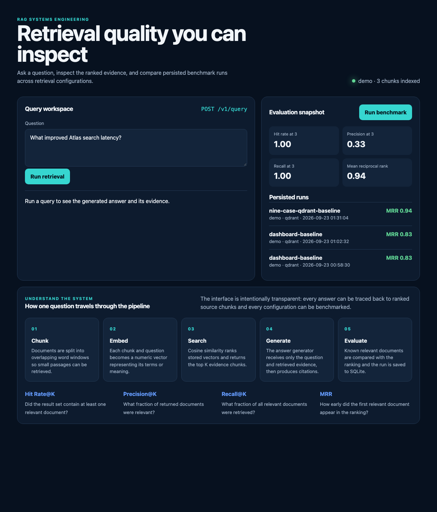
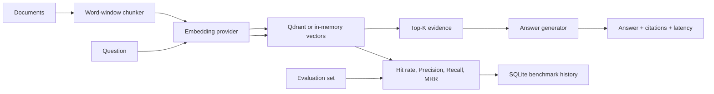

# RAG Benchmark Lab

A transparent, reproducible platform for testing retrieval-augmented generation systems.
It ingests documents, chunks and embeds them, persists vectors in Qdrant, retrieves evidence,
generates cited answers, and records benchmark runs with multiple retrieval metrics.



This repository remains small enough to understand end to end. It runs offline in `demo` mode
and can switch to OpenAI embeddings and generation with configuration only.

New to RAG? Start with the [learning guide](LEARNING_GUIDE.md). When you are ready to show the
project, use the [five-minute demo script](DEMO_SCRIPT.md) and the
[portfolio showcase kit](SHOWCASE.md). The `docs/` directory also contains a standalone
[project case study](docs/index.html) ready for GitHub Pages.

## Why this project exists

RAG demos often stop after producing a plausible answer. This lab makes the hidden parts
inspectable: the retrieved chunks, similarity scores, citations, latency, and evaluation
results. It creates a baseline that can later be compared with hybrid search, reranking,
vector databases, and GPU-hosted models.

## Architecture



The `demo` provider uses deterministic hashing embeddings and an extractive answerer. The
`openai` provider uses `text-embedding-3-small` plus the Responses API. Qdrant local mode keeps
vectors on disk, while the in-memory implementation provides a transparent baseline. All
implementations share interfaces so experiments can swap components through configuration.

## Quick start

```bash
python3.12 -m venv .venv
source .venv/bin/activate
python -m pip install '.[dev]'
test -f .env.local || cp .env.example .env.local
make test
make run
```

Open [http://localhost:8000](http://localhost:8000) for the benchmark dashboard or
[http://localhost:8000/docs](http://localhost:8000/docs) for the interactive API. Three
synthetic project documents are indexed automatically at startup.

Try a query:

```bash
curl -s http://localhost:8000/v1/query \
  -H 'Content-Type: application/json' \
  -d '{"question":"What improved Atlas search latency?","top_k":3}'
```

Run the baseline evaluation:

```bash
make evaluate
```

Inspect the active configuration without revealing a credential:

```bash
ragbench doctor
```

The command-line interface uses explicit subcommands:

```bash
ragbench query "What improved Atlas search latency?" --top-k 3
ragbench evaluate --name experiment-one --k 3
ragbench serve --reload
```

## OpenAI mode

Keep secrets in `.env.local`, which is ignored by Git:

```dotenv
RAGBENCH_PROVIDER=openai
OPENAI_API_KEY=your_key_here
RAGBENCH_CHAT_MODEL=gpt-5-mini
RAGBENCH_EMBEDDING_MODEL=text-embedding-3-small
```

The application uses the official Python SDK. Generation goes through the Responses API,
and retrieval vectors come from the embeddings API. Model names are configurable so the
repository does not require code changes when you test another model.

## API

| Method | Path | Purpose |
| --- | --- | --- |
| `GET` | `/` | Query and benchmark dashboard |
| `GET` | `/health` | Provider and index status |
| `POST` | `/v1/documents` | Ingest one or more documents |
| `POST` | `/v1/query` | Retrieve evidence and generate a cited answer |
| `POST` | `/v1/evaluate` | Calculate and persist retrieval metrics |
| `GET` | `/v1/runs` | List recent benchmark runs |

Example evaluation payload:

```json
{
  "name": "baseline-qdrant",
  "k": 3,
  "examples": [
    {
      "question": "How was Atlas search accelerated?",
      "relevant_document_ids": ["atlas"]
    }
  ]
}
```

Each run records Hit Rate@K, Precision@K, Recall@K, mean reciprocal rank, average retrieval
latency, the provider, and the storage backend. The case-level response shows retrieved document
IDs and scores so metric changes can be traced to concrete ranking behavior.

## Verified baseline

The packaged evaluation set contains nine labeled questions. The latest Qdrant demo run at
`K=3` produced:

| Metric | Result |
| --- | ---: |
| Hit Rate@3 | 1.0000 |
| Precision@3 | 0.3333 |
| Recall@3 | 1.0000 |
| Mean reciprocal rank | 0.9444 |
| Average retrieval latency | 0.80 ms |

One Atlas dashboard question places the correct document second, behind Beacon. This is an
intentional, visible baseline limitation and the first target for the planned hybrid retriever.

## Hybrid retrieval result

Set `RAGBENCH_RETRIEVAL_MODE=hybrid` to combine BM25 lexical ranks with vector ranks using
weighted reciprocal rank fusion. The lexical ranker is implemented directly in `store.py`, so the
scoring logic remains inspectable and adds no search dependency.

| Nine-case Qdrant run | Vector | Hybrid |
| --- | ---: | ---: |
| Hit Rate@3 | 1.0000 | 1.0000 |
| Precision@3 | 0.3333 | 0.3333 |
| Recall@3 | 1.0000 | 1.0000 |
| Mean reciprocal rank | 0.9444 | **1.0000** |
| Average retrieval latency | 0.80 ms | 1.29 ms |

Hybrid retrieval moves the missed Atlas case from rank two to rank one. The measured cost is an
additional `0.49 ms` of average retrieval latency in this local sample run.

```bash
RAGBENCH_RETRIEVAL_MODE=vector ragbench evaluate --name vector-baseline --k 3
RAGBENCH_RETRIEVAL_MODE=hybrid ragbench evaluate --name hybrid-rerank --k 3
```

## Persistent vector storage

Qdrant local mode is enabled by default and writes to `.ragbench/qdrant`. Restarting the API does
not rebuild an empty index. Chunk IDs map to deterministic UUIDs, so ingesting the same corpus is
idempotent rather than duplicating points.

Switch to the in-memory baseline when measuring raw implementation behavior:

```dotenv
RAGBENCH_STORE_BACKEND=memory
```

For larger or concurrent workloads, the same adapter can point to a Qdrant server in a future
milestone. Local mode intentionally favors a simple one-process developer experience.

## Repository map

```text
src/ragbench/
  api.py          FastAPI routes and dependency wiring
  chunking.py     Reproducible word-window chunking
  embeddings.py  Offline and OpenAI embedding providers
  generation.py  Offline and OpenAI answer generators
  store.py        In-memory cosine search and persistent Qdrant adapter
  evaluation.py   Hit rate, precision, recall, MRR, and latency
  experiments.py  SQLite benchmark-run repository
  service.py      End-to-end RAG orchestration
  static/         Interactive benchmark dashboard
  data/           Packaged sample corpus and nine-case evaluation set
tests/            Unit and API tests
```

## Roadmap

- Add a cross-encoder reranker and compare quality/latency tradeoffs.
- Add MLflow export and richer experiment comparison charts.
- Add a pgvector adapter and remote Qdrant configuration.
- Track faithfulness, answer relevance, citation correctness, cost, p50, and p95 latency.
- Benchmark local GPU inference against hosted generation.

## Responsible use

The included corpus is synthetic. Only ingest information you are authorized to process,
and never commit API keys, private employer data, customer records, or restricted documents.

## License

MIT
